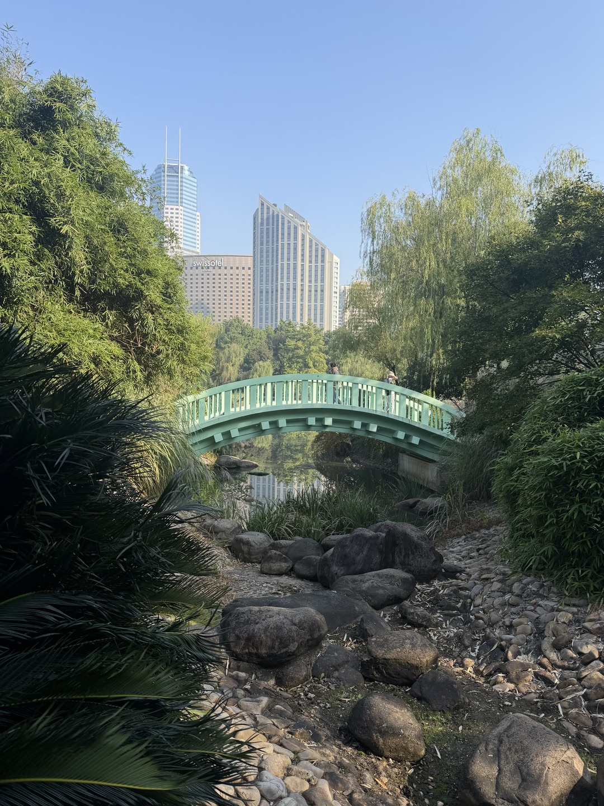
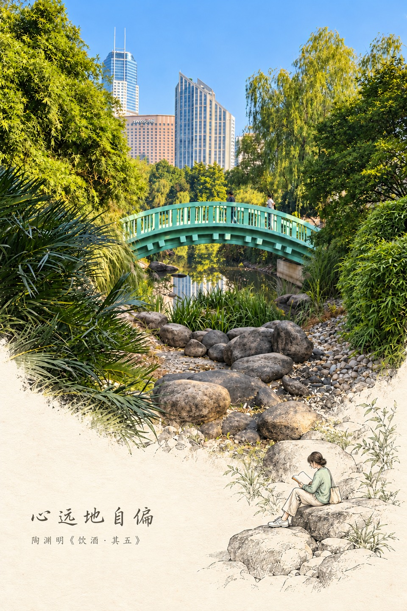
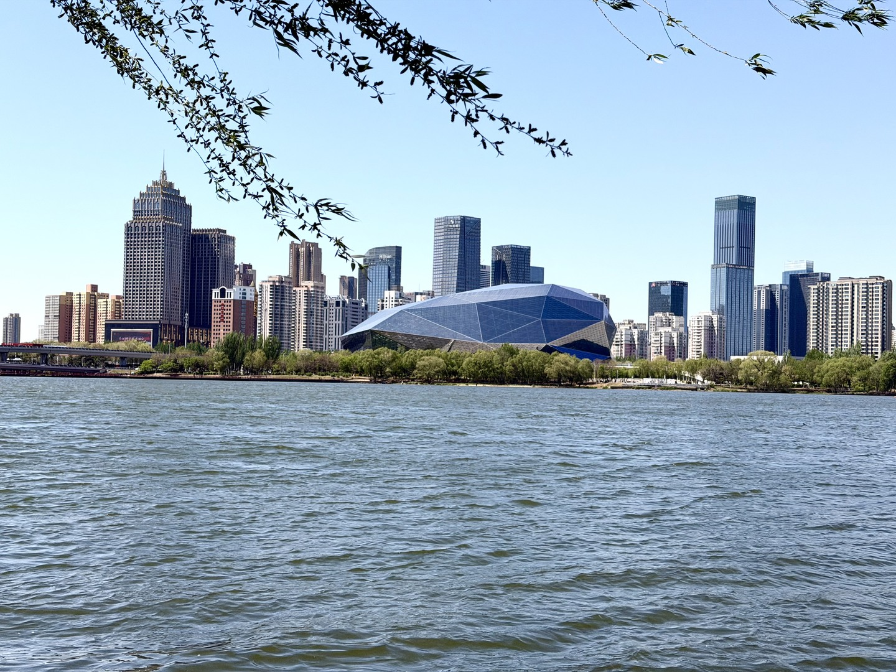
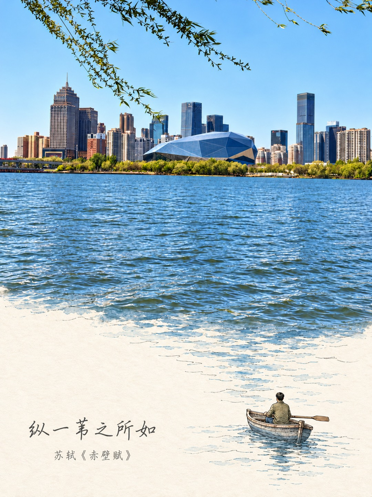
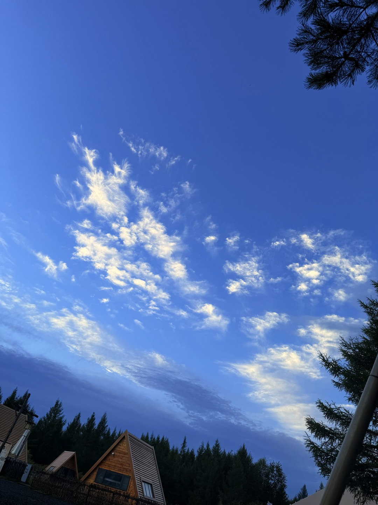
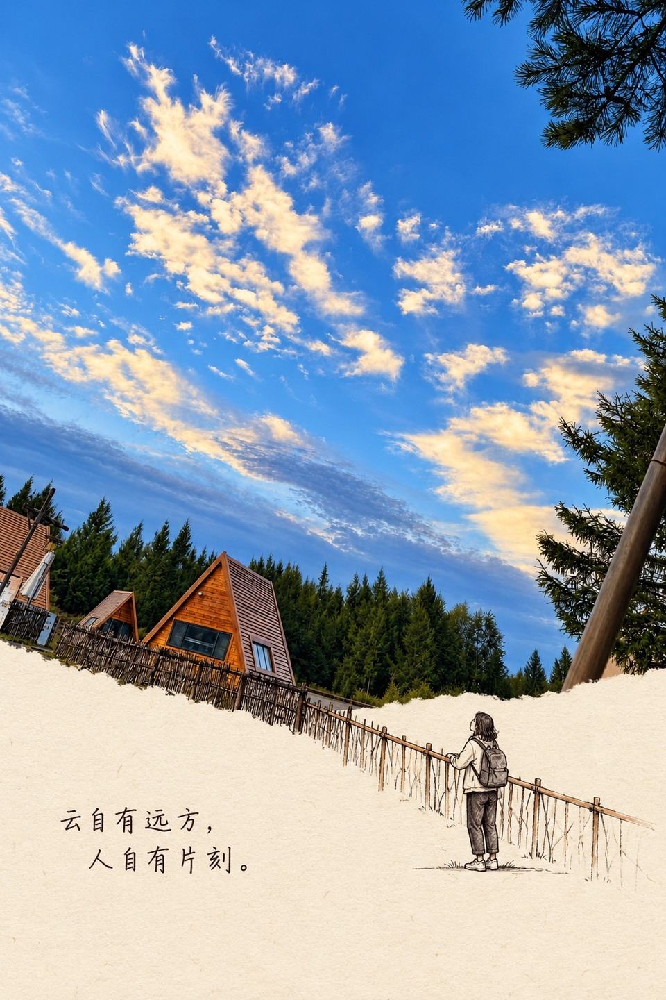

# 河图·手绘故事明信片

**v1.3.0 · hetu-photo-story-postcard**

把风景图先修得自然、协调，再从景物中接出纸上的手绘故事。提供地名或图片名称后，还会结合画面查找背景故事、诗句、名言或人物线索，优先选用经核实且贴景的诗词典故，没有合适引用再写凝练自洽的原创题句。

视觉结构：**美化后的原景 → 暖纸与跨界线条 → 小人物的一次动作 → 一句有余味的话**。

## 三组原图与成品对照

以下选自近期实际制作记录，经用户授权公开展示。左侧是未美化原图的网页预览，右侧是完成调色与手绘延展的明信片；点击图片可放大查看。预览文件仅做方向校正、等比缩放与压缩。

### 1. 上海虹桥公园 · 心远地自偏

<table>
  <tr><th width="50%">原图</th><th width="50%">手绘故事明信片</th></tr>
  <tr>
    <td align="center"><a href="docs/examples/hongqiao-before.jpg"></a></td>
    <td align="center"><a href="docs/examples/hongqiao-after.jpg"></a></td>
  </tr>
</table>

前景岩石顺势变成纸上石台，读者在石边静坐看书，远处楼宇仍然可见。题句引用陶渊明《饮酒·其五》“心远地自偏”，借身处人境而内心自静的意境，不暗示诗人与拍摄地有历史联系。[原文与注释](https://article.xuexi.cn/html/13395986728056917107.html?pid=&ptype=-1&share_to=copylink&source=share&study_style_id=feeds_default)

### 2. 沈阳浑河 · 纵一苇之所如

<table>
  <tr><th width="50%">原图</th><th width="50%">手绘故事明信片</th></tr>
  <tr>
    <td align="center"><a href="docs/examples/hunhe-before.jpg"></a></td>
    <td align="center"><a href="docs/examples/hunhe-after.jpg"></a></td>
  </tr>
</table>

河面水纹逐渐化为纸上淡墨，小舟上的人物停桨望向对岸。题句节引苏轼《赤壁赋》“纵一苇之所如”，“一苇”比喻小舟；这里借泛舟意境，不把浑河当作赤壁。[引文与词义依据](https://dict.revised.moe.edu.tw/dictView.jsp?ID=149954&la=1&powerMode=0)

### 3. 木屋与云 · 云与片刻

<table>
  <tr><th width="50%">原图</th><th width="50%">手绘故事明信片</th></tr>
  <tr>
    <td align="center"><a href="docs/examples/clouds-before.jpg"></a></td>
    <td align="center"><a href="docs/examples/clouds-after.jpg"></a></td>
  </tr>
</table>

木屋前的围栏延伸成细线，小人倚栏抬头看云；保留原片的倾斜视角，以一处停留回应开阔天空。题句“云自有远方，人自有片刻。”为此前制作的原创示例，无名人署名；拍摄地点未知。

三组中新增的手绘人物与动作均为艺术想象。生成式修图及延展会重构局部细节，这些对照展示构图与叙事效果，不代表原片像素不变。

## 如何工作

1. **看图与选构图**：判断主体、前后层次、可延伸的岸线/道路/枝条等。
2. **先修图**：优化色偏、曝光、明暗层次与色彩协调，保存美化版，不覆盖原图。
3. **名称选择题**：可填写地名或图片标题，也可选“不知道”。已有信息、固定文案和无字请求不重复问。
4. **查找与写作**：把画面理解和名称背后的素材相连；内部知识用于提出线索，可靠资料用于核实具体事实和原文。先核实原句与原义，再比较图文逻辑和语感，锁定题句后上图。
5. **手绘延展**：用细墨线、少量点色和小人物动作跨入暖纸留白；新增角色属于手绘想象，不冒充照片事实。
6. **检查交付**：核对美化效果、连接、人物接触点与文字，提供明信片、美化原片和提示词。

不是把任何照片都套成同一个模板，也不会承诺生成式编辑保持原片像素完全不变。

## 用法

上传图片并调用：

```text
$hetu-photo-story-postcard 把这张风景做成手绘故事明信片。
```

也可以自然语言说明：

- “用河图手绘故事明信片处理，这是西湖。结合相关诗意写一句中文。”
- “这张照片我叫它‘山里的来信’，从这个标题延展一个小故事。”
- “地点不知道，优先找贴合画面与动作的诗句，没有合适的再原创。”
- “先美化照片，再做无字版。”
- “从这三张里选最适合手绘延展的一张。”

上面是调用示例，不代表示例地点的文化研究已经执行。无字版不查文案素材。

## 怎样让短句更有意味

新版将“先审文，再上图”列为明确步骤。每个定稿记录白话释义、来源、画面支点和候选淘汰原因。优先尝试诗文原句、典故借意或化用；没有适用材料时再原创。没有地名也可以从画面意象检索，不能仅因用了古诗就称为更好。

以下问题会阻止候选上图：误引或断章取义、与动作/时令冲突、缺少因果或时间前提、强行拟人、空泛口号。通过这些检查后，再比较音节、留白与书写效果。只改已有成品文字时，保持画面其他部分。

以一个主要文化线索、一个画面意象和一个手绘动作形成关系。比如远山与手中画册可以形成远近对照；有关停留的主题可以落实成一个坐下、停笔或翻页的动作。材料先转化为意象，不堆地名、名人和典故。

- **原创**：从材料中得到启发，自己写句子，不署成名人原话。
- **化用**：借作品意象或典故重写，在交付说明中注明依据。
- **原文引用**：核对字词、作者与出处，使用贴切的短引文。

多段材料组合出的句子是新创作或化用，不是任何一位作者的原话。传说与史实、人物真实到访与主题关联分别处理。资料无法核实时回到可靠的画面原创，不编造出处。

## 选图建议

优先清晰原图，主体明确，保留边缘与近景。岸线、山路、石阶、树枝、溪流、桥栏、岩坡和屋檐通常更容易自然接出故事；有前后景层次更好。横竖均可，阴天、雾景和夜景也可以。

纯天空、无岸线水面、密集人群、杂乱特写或严重模糊图片，更适合简洁延展、调整摄影窗口或减少人物。以上是设计建议，不是批量实测排名。

## 安装

这是带 `SKILL.md` 与 `agents/openai.yaml` 的文件夹技能。需要宿主能读取图片并调用图像编辑工具；名称研究需要联网检索或可核实资料。技能本身不附带图像模型、API 密钥或第三方收费服务。

在支持本地技能的 Codex 环境，可将仓库根目录放到 `$CODEX_HOME/skills/hetu-photo-story-postcard`；未设置 `CODEX_HOME` 时默认使用 `~/.codex/skills/hetu-photo-story-postcard`。例如首次安装：

```bash
git clone https://github.com/wuhetu619-crypto/hetu-photo-story-postcard.git
mkdir -p "${CODEX_HOME:-$HOME/.codex}/skills"
cp -R hetu-photo-story-postcard "${CODEX_HOME:-$HOME/.codex}/skills/"
```

若已有同名技能，先备份再更新，避免覆盖个人修改。在 ChatGPT 提供技能包上传入口的环境，可使用 Releases 中的 ZIP，具体支持情况以实际界面为准。本地文件夹安装不等于网页端账号同步。

## 内容导航

| 文件 | 用途 |
| --- | --- |
| [SKILL.md](SKILL.md) | 入口、流程与默认行为 |
| [调色美化](references/image-enhancement.md) | 第一阶段修图 |
| [地点与短句](references/location-caption.md) | 选择题、文案分支与打磨 |
| [题句选择与审校](references/caption-editorial.md) | 引用优先、原创方法、逻辑关卡与选句卡 |
| [名称背景研究](references/name-story-research.md) | 素材查找、事实核实与融合 |
| [选图指南](references/input-selection.md) | 什么图适合，难图如何适配 |
| [故事连接](references/story-bridges.md) | 景物如何接出动作 |
| [视觉语法](references/visual-grammar.md) | 纸、线、颜色、版式与尺度 |
| [五图文字图谱](references/style-atlas.md) | 风格提炼，不含参考原图 |
| [生成提示词](references/prompt-template.md) | 两阶段执行模板 |
| [质量检查](references/quality-review.md) | 成图核验、系列与交付 |
| [GitHub 对照](references/github-comparison.md) | 创建 v1.0.0 时的参考与取舍 |
| [版本记录](CHANGELOG.md) | 版本变化 |

公开仓库仅在 `docs/examples/` 收录上述三组经用户授权的原图与成品网页预览；其余个人照片、输出及第三方风格样片不随仓库发布。示例图片用于展示，不是技能运行的必需输入。本机可配备自己的参考图，缺少参考图片也能依文字规范工作。

## 验证范围

v1.3.0 完成技能结构、内部链接、元数据及安装一致性检查，并用一张既有河景明信片执行了“核实引文—图文审校—局部改字—看图核验”。其余无地点、明确原创、无字和指定文案分支进行了静态走查，见 [验证记录](references/validation-v1.3.0.md)。这些检查不等于大规模审美评测，也不保证每张图片都一次生成成功。

原有同景版画风格见 [hetu-landscape-postcard](https://github.com/wuhetu619-crypto/hetu-landscape-postcard)。两个技能分别维护。
